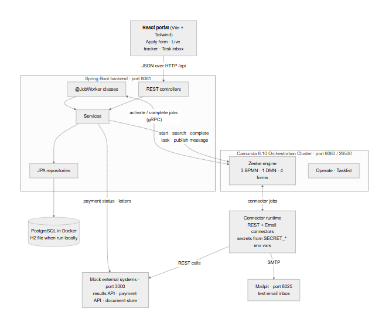
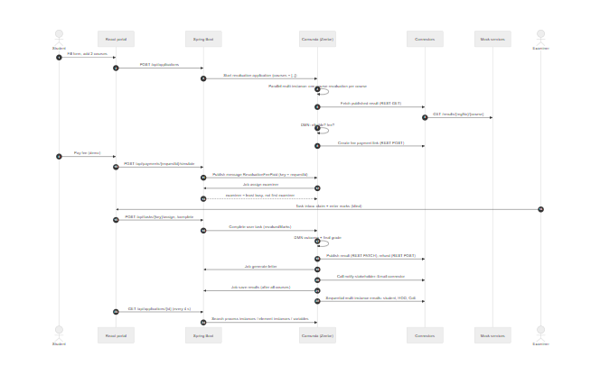
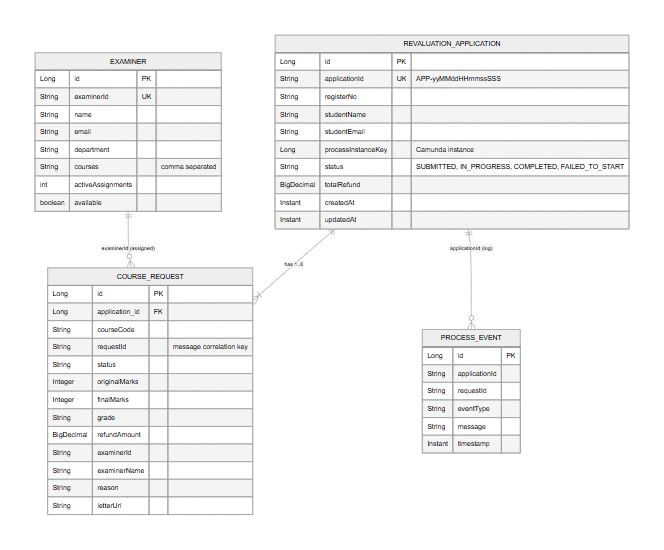
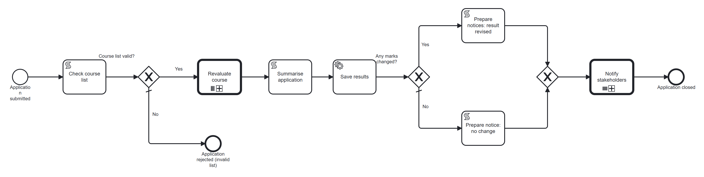
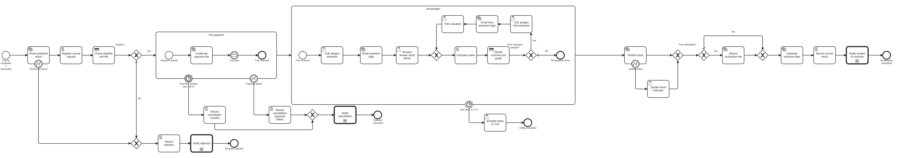
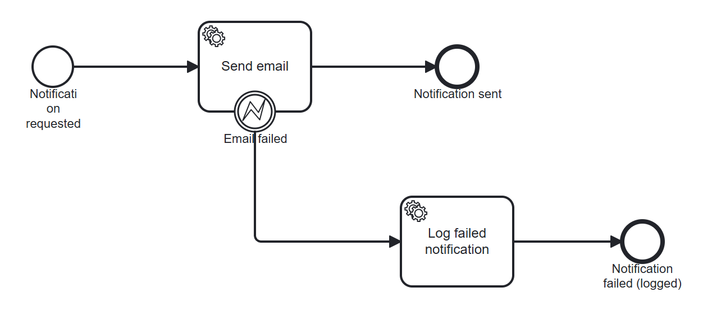

# Examination Revaluation System — Camunda 8 full-stack application

**21CSE735P Workflow Automation Engineering · Project 17 · Final phase**
Ram Prasath N (RA2411026011139) · Suriya Narayanan S (RA2411026011141) · Section AG2 · Department of Computational Intelligence, SRM Institute of Science and Technology, Kattankulathur

A student applies online to have one or more exam papers revalued. Every course then runs through its own automated workflow: fetch the published result, check eligibility, collect the fee, assign an examiner, revalue blind, run a third valuation if needed, publish the result, refund the fee if the marks went up, and email everyone involved. The workflows run on **Camunda 8.10**. A **Spring Boot** backend holds the business services and job workers, and a **React** portal is used by students, examiners and the Examination Cell.

---

## 1. Rubric checklist (status and evidence)

Every row has been run for real on Camunda 8 Run 8.10.6; the Docker row was also run from a fresh copy of the repository. Screenshots are in [`docs/screenshots/`](docs/screenshots).

| Milestone | Criterion | Max | Status | Evidence |
|---|---|---|---|---|
| 1 | BPMN 2.0 executability | 5 | Done | All 3 BPMN files, 1 DMN file and 4 forms are deployed by the backend at startup and run end to end. Lint: 0 errors (`bpmnlint` with `camunda-cloud-8-10` rules). Every exclusive gateway has a default flow. Screenshots `01`–`03`. |
| 1 | Mandatory constructs | 10 | Done | **Call Activities:** `Call_RevaluateCourse` calls `course-revaluation`; `notify-stakeholder` is reused 4 times. **Parallel Multi-Instance:** one course instance per course. **Sequential Multi-Instance:** stakeholder emails (student → HOD → CoE). **Sub-processes with Error + Timer boundary events:** `Sub_FeePayment` (interrupting 48 h timer, `PAYMENT_FAILED` error) and `Sub_Revaluation` (non-interrupting 72 h timer). See §6. |
| 1 | Connectors and FEEL | 5 | Done | REST connector ×4 (fetch result, payment link, publish result, refund) and Email connector (SMTP to Mailpit). Secrets are `camunda.secrets.*`, with values in `secrets/secrets.env` / `.env` and never in git. All FEEL is listed in §9, and 26 expressions are checked by `scripts/feel-check.mjs` ([output](docs/evidence/feel-check-output.txt)). |
| 1 | Data contract and scoping | 5 | Done | Every Call Activity has `propagateAllParentVariables="false"`, `propagateAllChildVariables="false"` and explicit input/output mappings. The Multi-Instance `inputElement`/`outputElement` are local to each instance. See §10. |
| 2 | Spring Boot and job workers | 8 | Done | REST controllers, service layer, Spring Data JPA repositories (H2 locally, PostgreSQL in Docker), four strongly typed `@JobWorker` classes using `@VariablesAsType` records. BPMN error: `CamundaError.bpmnError("NO_EXAMINER_AVAILABLE", …)`. 12 unit tests pass ([output](docs/evidence/backend-unit-tests.txt)). |
| 2 | React frontend portal | 8 | Done | Dynamic course array builder (`ApplyPage.jsx`), custom task inbox (`TaskInboxPage.jsx`), live status tracker with bpmn-js highlighting (`ApplicationDetailPage.jsx`). Screenshots `11a`–`11j`. |
| 2 | Camunda 8 engine integration | 5 | Done | React → Spring Boot REST → Camunda Java client (start instance, search, assign/complete user task, publish message), and job workers over gRPC. Full run through the portal: `APP-261118081942740`, screenshots `11b`–`11j` and `01`–`04`. |
| 2 | Docker packaging | 4 | Done (run from a fresh copy) | `docker-compose.yml` (8 services), 3 Dockerfiles, `nginx.conf`, `.env.example`. Run on 18 Nov 2026 from a fresh copy of the repository: first build 535 s, all containers healthy, the full demo scenario and the email-failure scenario passed through the portal on :5173, with results in PostgreSQL ([output](docs/evidence/docker-run-output.txt), screenshots `12a`–`12c`). See §7.1. |

> **About `ZeebeBpmnError`:** the rubric names `ZeebeBpmnError`, which came from the old spring-zeebe library. In the Camunda 8.10 Spring Boot starter used here, the same thing is done with `CamundaError.bpmnError(code, message)` (class `io.camunda.client.exception.BpmnError`). See `AssignExaminerWorker.java`.

## 2. Gap table (Review 2 → final)

| Requirement | Review 2 | Final |
|---|---|---|
| Main BPMN + reusable Call Activities | Missing (one flat process) | 3 processes: parent `revaluation-application`, children `course-revaluation` and `notify-stakeholder` |
| Parallel Multi-Instance | Missing | `Call_RevaluateCourse` over `courses` |
| Sequential Multi-Instance | Missing | `Call_NotifyStakeholders` over `recipients` |
| Sub-process with Error + Timer boundary | Boundaries on tasks only | `Sub_FeePayment` (timer + error), `Sub_Revaluation` (timer) |
| Gateways | Done | Kept; every split has a default flow |
| REST connector | Done | Kept (4 tasks) |
| Email connector | Missing (Node worker) | Email connector → SMTP → Mailpit |
| Externalized secrets | c8run only | Camunda file secret store: filled by `c8run secrets import` locally, and from `.env` by `camunda-data-init` in Docker |
| FEEL + scoping | Partial | Explicit mappings everywhere; FEEL dictionary + automated check |
| Spring Boot REST controllers | Missing (Node scripts) | `ApplicationController`, `TaskController`, `SupportController` |
| H2/PostgreSQL + JPA | Missing | 4 entities, 4 repositories |
| Strongly typed `@JobWorker` | Missing (Node workers) | 4 Java workers with record types |
| BPMN error handling in Java | Node only | `CamundaError.bpmnError` + error boundary |
| Service + repository layers | Missing | `service/`, `repository/` packages |
| React UI | Missing | Apply, Applications, Tracker, Task inbox |
| Dynamic array item builder | Missing | Course list builder → `courses` |
| Custom Tasklist inbox | Missing | `TaskInboxPage.jsx` |
| Live status tracker | Missing | `ApplicationDetailPage.jsx` (polls every 4 s, diagram highlight) |
| Validation + feedback | Missing | Client- and server-side validation, toasts |
| Dockerfile / compose | Missing | Written and run from a fresh copy (§7.1) |
| README with FEEL dictionary | Missing | This file |

### Changes made to the Review 2 logic (and why)

The business rules are unchanged: the DMN tables, the 7-day window, the ₹1,000 fee, 48 h / 72 h deadlines, the more-than-15-marks third-valuation rule, auto-assignment, the publish-failure fallback and the refund rule. These are the structural changes:

1. **One process became three.** Review 2 handled one course per process. Now a parent process takes a list of courses and starts one `course-revaluation` per course (parallel Multi-Instance), as the guidelines require.
2. **Payment wait:** the event-based gateway (message vs. 48 h timer) became the **Fee payment sub-process**. Inside it, the process waits for the message; on its border sit an *interrupting* timer (48 h) and a `PAYMENT_FAILED` error boundary. The behaviour is the same (pay in time or the request is cancelled), but it now meets the "sub-process with error and timer boundary" requirement.
3. **The 72 h examiner timer** moved from the "Revalue answer script" task to the border of the **Revaluation sub-process** (still non-interrupting). Escalation now also covers manual assignment and third valuation.
4. **Third valuation** goes to the candidate group `senior-examiners` instead of `examiners`, so a different person does it.
5. **Lanes removed.** Camunda 8 ignores lanes, and they made the three diagrams harder to read. Roles are shown by candidate groups instead.
6. **Notifications:** the Node notification worker was replaced by the **Email connector** in the reusable `notify-stakeholder` process. A failed email is caught (`EMAIL_FAILED`), logged on the application timeline, and does not stop the revaluation.
7. **Examiner directory** moved from the mock service into the database (`examiner` table), because the assignment worker is now Java with JPA.
8. **`applicationId`** is generated by the backend (`APP-yyMMddHHmmssSSS`, Indian Standard Time). The per-course `requestId` is still built in FEEL (`REV-<registerNo>-<course>-<suffix>`, at most 40 characters for Razorpay's `reference_id`).
9. **Results API URL** is now a secret (`RESULTS_API_URL`), so the same BPMN works on c8run (`localhost`) and in Docker (`mock-services`).
10. **Mock services:** removed `/examiners` and `/notifications` (now handled by the DB and Mailpit). Added failure toggles `paymentsDown` and `lettersDown`, the test course `21CSE251T`, and `PUBLIC_URL`.

## 3. Business problem

Revaluation at most universities is a paper process. The student fills a form, pays at a counter, and the Examination Cell matches payments to forms, finds an examiner who did not value the script the first time, chases late examiners, re-enters marks into the results system and refunds fees by hand. The student cannot see where the request is.

This system automates that. Each step is a BPMN element that you can see live in Camunda Operate, and the student sees the same state in the portal.

**Design assumptions** (project choices, not confirmed SRM policy): apply within 7 days of the result, ₹1,000 fee per theory course, practical courses are not revalued, pay within 48 hours, examiner finishes within 72 hours, and a difference of more than 15 marks triggers a third valuation by a senior examiner.

## 4. Technology stack (exact versions)

| Layer | Technology | Version |
|---|---|---|
| Workflow engine | Camunda 8 Run (local) / `camunda/camunda` image (Docker) | 8.10.6 / 8.10.9 |
| Connectors | Bundled in c8run / `camunda/connectors-bundle` | 8.10.2 / 8.10.5 |
| Backend | Spring Boot, Java | 3.5.16, Java 21 |
| Camunda client | `io.camunda:camunda-spring-boot-3-starter` | 8.10.9 |
| Database | H2 (local file) / PostgreSQL (Docker) | bundled / 16 |
| Frontend | React, React Router, Vite, Tailwind CSS, bpmn-js | 19.3.1, 7.18.5, 8.3.8, 4.3.5, 18.33.0 |
| Test email | Mailpit | v1.34 (Docker) |
| Mock systems | Node.js (no packages) | 24 |
| Containers | Docker Compose, nginx | compose v2, nginx 1.29 |

## 5. Architecture



- The **React portal never calls Camunda directly.** It calls the Spring Boot REST API (`/api/...`), and the backend uses the Camunda Java client. This keeps Camunda's API and its credentials off the browser, and puts validation and the "blind" rule (examiners never see the original marks) in one place.
- **Job workers** (`@JobWorker`) in the backend do the custom work: assign an examiner, generate the letter, save results, log failed emails.
- The **connector runtime** does the standard integrations (REST, Email) declared in the BPMN, using secrets.
- **Mock services** stand in for the results system, the Razorpay payment API and a document store. **Mailpit** catches every email.

Sequence of the happy path:



Database (entity relationship diagram):



### 5.1 BPMN diagrams

**Parent: `revaluation-application.bpmn`.** It checks the course list, revalues every course in parallel, summarises, then notifies stakeholders one after another.


**Child: `course-revaluation.bpmn`** (one instance per course).


**Reusable child: `notify-stakeholder.bpmn`.** Sends one email; a failure is logged, not fatal.


## 6. Mandatory constructs: where and why

| Construct | Element ID | Why it is used here |
|---|---|---|
| Call Activity (reusable) | `Call_RevaluateCourse` → `course-revaluation` | A course revaluation is a complete process of its own, with its own timers, errors and history. Making it a separate process lets Operate show each course as its own instance, and it can be versioned on its own. |
| Call Activity (reused 4×) | `Call_NotifyOutcome`, `Call_NotifyRejection`, `Call_NotifyCancelled`, `Call_NotifyStakeholders` → `notify-stakeholder` | One email process with one failure path, called from two different processes. |
| Parallel Multi-Instance | `Call_RevaluateCourse` (`inputCollection =courses`, `inputElement courseCode`, `outputCollection courseResults`, `outputElement =courseResult`) | Courses do not depend on each other. A student with 3 courses should not wait for course 1 before course 2 starts. |
| Sequential Multi-Instance | `Call_NotifyStakeholders` (`inputCollection =recipients`, `inputElement recipient`) | The student must hear first, then the Head of Department (HOD), then the Controller of Examinations (CoE). Order matters, so the instances run one at a time. Mailpit shows them in that order. |
| Sub-process + interrupting Timer boundary | `Sub_FeePayment` + `Boundary_PaymentDeadline` (`=get or else(paymentWindow, "PT48H")`) | If the fee is not paid in time, the whole payment step is cancelled and the request is closed as CANCELLED. |
| Sub-process + Error boundary | `Sub_FeePayment` + `Boundary_PaymentFailed` (`PAYMENT_FAILED`) | If the payment API fails (HTTP 4xx/5xx), the request is cancelled cleanly with a clear reason, and no money is taken. |
| Sub-process + non-interrupting Timer boundary | `Sub_Revaluation` + `Boundary_ExaminerDeadline` (`=get or else(examinerDeadline, "PT72H")`) | After 72 h the CoE gets an escalation task, but the examiner's task stays open (non-interrupting). Nobody's work is thrown away. |
| Task-level Error boundaries | `RESULT_NOT_FOUND` on `Task_FetchResult`, `NO_EXAMINER_AVAILABLE` on `Task_AssignExaminer`, `RESULT_UPDATE_FAILED` on `Task_PublishResult`, `EMAIL_FAILED` on `Task_SendEmail` | Expected business problems get their own path (rejection, manual assignment, manual update, logged email failure) instead of an incident. |
| DMN (FIRST and UNIQUE hit policies) | `revaluation-eligibility`, `revaluation-outcome` (FIRST), `marks-to-grade` (UNIQUE) | Rules that the Examination Cell may change live in tables, not code. |

**BPMN error vs. incident.** A *BPMN error* is an expected business outcome: the worker or connector throws a named error code, and a boundary event in the model catches it (example: no examiner available → manual assignment). An *incident* is a technical failure: the worker throws an ordinary exception, Camunda retries the job (3 times here), and when retries run out it raises an incident in Operate that a person must fix and resolve. Both were demonstrated: scenario 5 for the BPMN error, scenario 9 for the incident (screenshot `09a`).

## 7. Setup and run

### 7.1 Docker (everything in containers)

> Status: tested on 18 Nov 2026 (Windows 11, Docker Engine 29.9.3) from a fresh copy of the repository with `.env` copied from `.env.example`. The first build took about 9 minutes; the demo scenario and the email-failure scenario passed. Evidence: [docs/evidence/docker-run-output.txt](docs/evidence/docker-run-output.txt), screenshots `12a`–`12c`.

Install Docker Desktop once: `winget install -e --id Docker.DockerDesktop` (Windows) or `brew install --cask docker` (macOS). Start it, then check `docker version`.

Windows PowerShell:
```powershell
cd RA2411026011139-examination-revaluation
copy .env.example .env
docker compose up -d --build
docker compose ps
```
macOS / Linux:
```bash
cd RA2411026011139-examination-revaluation
cp .env.example .env
docker compose up -d --build
docker compose ps
```
Then open: portal http://localhost:5173 · Operate http://localhost:8080/operate (demo/demo) · Mailpit http://localhost:8025 · mock dashboard http://localhost:3000.
The first build downloads about 2 GB and takes several minutes. Stop with `docker compose down`; add `-v` to also delete the data volumes.

Stop c8run and the local servers first: they use the same ports (8080, 26500, 8081, 3000, 5173, 1025, 8025).

### 7.2 Local (no Docker): Camunda 8 Run + Maven + Vite

This is the path used for the live demo; all 12 scenarios in §12 were run on it.

Needs: Camunda 8 Run 8.10.6 (`C:\camunda\c8run-8.10.6`), Java 21, Maven 3.9, Node.js 24, Mailpit (`winget install -e --id axllent.mailpit` / `brew install mailpit`).

- Windows: double-click **`start-demo.bat`**. It starts c8run, imports the connector secrets, and opens windows for Mailpit, the mock services, the backend and the frontend. Stop with **`stop-demo.bat`**.
- macOS: `chmod +x start-demo.sh stop-demo.sh` once, then `./start-demo.sh`; stop with `./stop-demo.sh`. Logs are in `logs/`. (Set `C8RUN=/path/to/c8run-8.10.6` if it is not in `~/camunda/`.)

Manual steps, if you prefer (Windows; on macOS use `./c8run` and `cp`):
```powershell
C:\camunda\c8run-8.10.6\c8run.exe start --no-browser
copy secrets\secrets.example.env secrets\secrets.env
C:\camunda\c8run-8.10.6\c8run.exe secrets import secrets\secrets.env
mailpit --smtp-auth-accept-any --smtp-auth-allow-insecure        # window 1
node mock-services\mock-services.js                              # window 2
cd backend-springboot; mvn spring-boot:run                       # window 3 (deploys the models)
cd frontend-react; npm install; npm run dev                      # window 4 -> http://localhost:5173
```

### 7.3 Tests

```bash
cd backend-springboot && mvn test          # 12 JUnit tests (validator, examiner assignment, worker BPMN error, controller validation)
cd scripts && npm install && npm run feel  # 26 FEEL expressions read from the BPMN files and evaluated
```

## 8. Configuration, environment variables and secrets

| Variable | Used by | Local default | Docker value |
|---|---|---|---|
| `CAMUNDA_GRPC_ADDRESS` / `CAMUNDA_REST_ADDRESS` | backend | `http://localhost:26500` / `:8080` | `http://orchestration:26500` / `:8080` |
| `DB_URL`, `DB_USERNAME`, `DB_PASSWORD` | backend | H2 file `./data/revaldb`, `sa` | PostgreSQL `revaldb`, from `.env` |
| `MOCK_SERVICES_URL`, `PAYMENT_API_URL` | backend | `http://localhost:3000`, `…/razorpay/v1` | `http://mock-services:3000`, `…/razorpay/v1` |
| `RAZORPAY_KEY_ID`, `RAZORPAY_KEY_SECRET` | backend + connectors | `rzp_test_mock`, `mock_secret` | from `.env` |
| `HOD_EMAIL`, `COE_EMAIL` | backend (start variables) | `hod.cse@srmist.test`, `coe@srmist.test` | same |
| `FRONTEND_ORIGIN` | backend CORS | `http://localhost:5173` | (nginx proxies, so CORS is unused) |
| `PUBLIC_URL` | mock services | `http://localhost:3000` | `http://localhost:3000` (address the browser uses) |

**Connector secrets.** The BPMN files contain only references such as `=camunda.secrets.SMTP_HOST`, never values. In Camunda 8.10 the **engine** resolves these references from its secret store just before it hands the job to the connector runtime; the values are never written to process variables, Operate or logs. Self-Managed Camunda supports a file, AWS or GCP store; this project uses the file store, which is a folder with one file per secret (file name = secret name, content = value):

| Secret | Meaning |
|---|---|
| `RESULTS_API_URL` | Base URL of the results system |
| `PAYMENT_API_URL` | Base URL of the (Razorpay-shaped) payment API |
| `RAZORPAY_KEY_ID`, `RAZORPAY_KEY_SECRET` | HTTP basic-auth keys for the payment API |
| `SMTP_HOST`, `SMTP_PORT`, `SMTP_USERNAME`, `SMTP_PASSWORD` | Mail server for the Email connector |

- **c8run:** values in `secrets/secrets.env` (git-ignored); `c8run secrets import` copies them into c8run's file store (`c8run secrets path` shows where). `secrets/secrets.example.env` is the committed template.
- **Docker:** values in `.env` (git-ignored; `.env.example` is the template). The one-off `camunda-data-init` container writes one file per secret into the `camunda-secrets` volume, and `camunda/application.yaml` points the engine at it with `camunda.secrets.stores.file.default.path`. The connectors container needs no secrets of its own.
- All values here are test values for local mock services. No real keys are in the repository.

## 9. FEEL expression dictionary

Friendly Enough Expression Language (FEEL) is the expression language Camunda uses in BPMN and DMN. An expression starts with `=` in the model. Every "Example" below was produced by `scripts/feel-check.mjs`, which reads the expression from the BPMN file and evaluates it ([full output](docs/evidence/feel-check-output.txt)).

### Parent process `revaluation-application.bpmn`

| Element ID | Expression | What it computes | Example input → output |
|---|---|---|---|
| `Task_CheckApplication` (script → `applicationCheck`) | `{courseCount: count(courses), hasDuplicates: count(courses) != count(distinct values(courses)), valid: count(courses) > 0 and count(courses) = count(distinct values(courses))}` | Whether the course list is non-empty and has no duplicates (a second check after the backend's) | `courses=["21CSC305P","21CSC305P"]` → `{courseCount:2, hasDuplicates:true, valid:false}` |
| `Flow_ListValid` (condition) | `applicationCheck.valid = true` | Takes the "Yes" path; otherwise the default flow ends the application | `valid:true` → `true` |
| `Call_RevaluateCourse` (multi-instance) | `inputCollection =courses`, `inputElement courseCode`, `outputElement =courseResult` | One course instance per list item; collects each instance's `courseResult` into `courseResults` | `["21CSC305P","21CSE251T"]` → 2 parallel instances |
| `Call_RevaluateCourse` (inputs) | `=applicationId`, `=registerNo`, `=studentName`, `=studentEmail`, `=courseCode`, `=paymentWindow`, `=examinerDeadline` | Exactly what the child receives (nothing else is copied) | — |
| `Task_Summarise` (script → `summary`) | `{total: count(courseResults), changed: count(courseResults[item.status = "CHANGED"]), …, totalRefund: sum(for r in courseResults return r.refundAmount), lines: string join(for r in courseResults return …, "\n")}` | Counts per outcome, total refund, one text line per course for the email | 1 CHANGED (₹1000) + 1 REJECTED → `{total:2, changed:1, rejected:1, totalRefund:1000, lines:"21CSC305P: CHANGED (final marks 74, grade A)\n21CSC306L: REJECTED - Practical, …"}` |
| `Flow_Changed` (condition) | `summary.changed > 0` | Whether HOD and CoE must be told | `changed:1` → `true` |
| `Task_PrepareRevised` (script → `recipients`) | `[{role:"STUDENT", name: studentName, email: studentEmail}, {role:"HOD", …, email: hodEmail}, {role:"COE", …, email: coeEmail}]` | The ordered list for the sequential multi-instance | → 3 recipients, student first |
| `Task_PrepareNoChange` (script → `recipients`) | `[{role:"STUDENT", name: studentName, email: studentEmail}]` | Only the student is told | → 1 recipient |
| `Call_NotifyStakeholders` (inputs) | `recipient =recipient`, `subject ="Revaluation application " + applicationId + " - summary"`, `body = "Dear " + recipient.name + …` | Email for the current loop item | `applicationId="APP-261118081942740"` → `"Revaluation application APP-261118081942740 - summary"` |

### Child process `course-revaluation.bpmn`

| Element ID | Expression | What it computes | Example input → output |
|---|---|---|---|
| `Task_FetchResult` (url) | `camunda.secrets.RESULTS_API_URL + "/results/" + registerNo + "-" + courseCode` | Results API address | → `http://localhost:3000/results/RA2411026011139-21CSC305P` |
| `Task_FetchResult` (result expression) | `{courseName: response.body.courseName, courseType: …, originalMarks: response.body.marks, originalGrade: …, resultPublishedOn: …, originalExaminerId: response.body.examinerId}` | Copies only the needed fields from the response | `marks:68` → `originalMarks:68` |
| `Task_FetchResult` (error expression) | `if error.code = "404" then bpmnError("RESULT_NOT_FOUND", "No published result for this course") else null` | Turns a 404 into a BPMN error (rejection path); other errors become incidents | `error.code="404"` → `RESULT_NOT_FOUND` |
| `Task_Register` (script → `application`) | `{requestId: "REV-" + registerNo + "-" + courseCode + "-" + string(modulo(floor((now() - date and time("2026-01-01T00:00:00@UTC")) / duration("PT0.001S")), 100000000)), daysSinceResult: (today() - date(resultPublishedOn)).days, submittedOn: string(today())}` | Unique request ID (milliseconds suffix, at most 40 characters) and the days since publication | real run → `REV-RA2411026011139-21CSC305P-44582966` (checked on the engine, not in feelin) |
| `Task_Eligibility` (DMN → `eligibility`) | table `revaluation-eligibility` on `application.daysSinceResult`, `courseType` | `{eligible, fee, reason}` | 1 day, THEORY → `{eligible:true, fee:1000}` |
| `Flow_Eligible` (condition) | `eligibility.eligible = true` | Fee path; default flow → rejection | → `true` |
| `Task_PaymentLink` (body) | `{amount: eligibility.fee * 100, currency: "INR", description: "Revaluation fee - " + courseCode, reference_id: application.requestId, customer: {name: studentName, email: studentEmail}, notify: {email: true}}` | Razorpay payment link request (amount in paise) | `fee:1000` → `amount:100000` |
| `Task_PaymentLink` (result) | `{paymentLinkId: response.body.id, paymentUrl: response.body.short_url}` | Link for the student | — |
| `Task_PaymentLink` (error expression) | `if error != null and error.code != null and matches(error.code, "^[45][0-9][0-9]$") then bpmnError("PAYMENT_FAILED", "Payment service returned HTTP " + error.code) else null` | HTTP 4xx/5xx → BPMN error caught on the sub-process | `"503"` → `PAYMENT_FAILED, "Payment service returned HTTP 503"` |
| `Message_FeePaid` (correlation key) | `application.requestId` | Which waiting course instance a payment belongs to | → `REV-RA2411026011139-21CSC305P-44582966` |
| `TimerDef_PaymentDeadline` | `get or else(paymentWindow, "PT48H")` | 48 h, or a demo override | none → `PT48H`; `"PT1M"` → `PT1M` |
| `Task_AssignManual` (output) | `examiner = {id: "MANUAL", name: examinerName, email: examinerEmail}` | Same shape as the worker's `examiner` | → `{id:"MANUAL", name:"Dr. F. Anand", …}` |
| `Task_CompareMarks` (script → `markDifference`) | `revaluedMarks - originalMarks` | Difference used by the outcome table | `66 - 47` → `19` |
| `Task_DecideOutcome` (DMN → `decision`) | table `revaluation-outcome` | `{outcome, finalMarks, refundFee}`; difference > 15 → `THIRD_VALUATION` (once) | 19, first time → `THIRD_VALUATION` |
| `Flow_ThirdNeeded` (condition) | `decision.outcome = "THIRD_VALUATION"` | Loop to the senior examiner | → `true` |
| `Task_ThirdValuation` (outputs) | `revaluedMarks =thirdValuationMarks`, `thirdValuationDone =true` | Third mark replaces the first revaluation; the loop runs only once | 52 → `revaluedMarks:52` |
| `TimerDef_ExaminerDeadline` | `get or else(examinerDeadline, "PT72H")` | 72 h, or a demo override | none → `PT72H` |
| `Task_FinalGrade` (DMN → `grading`) | table `marks-to-grade` on `decision.finalMarks` | `{grade, gradePoint}` | 74 → `A` |
| `Task_PublishResult` (body / error) | `{revaluation: {requestId, outcome: decision.outcome, finalMarks: decision.finalMarks, finalGrade: grading.grade, completedOn: string(today())}}` / `if error != null then bpmnError("RESULT_UPDATE_FAILED", …)` | Updates the results system; any failure → manual update task | — |
| `Flow_Refund` (condition) | `decision.refundFee = true` | Refund only when marks increased | → `true` |
| `Task_Refund` (url, body) | `camunda.secrets.PAYMENT_API_URL + "/payments/" + paymentId + "/refund"`, `{amount: eligibility.fee * 100, notes: {…}}` | Refund request | `pay_123` → `…/payments/pay_123/refund` |
| `Task_RecordOutcome` (script → `courseResult`) | `{courseCode, courseName, requestId: application.requestId, status: if decision.outcome = "RESULT_REVISED" then "CHANGED" else "UNCHANGED", …, refundAmount: if decision.refundFee then eligibility.fee else 0, examinerName: examiner.name, letterUrl: letter.url}` | The one result object the parent collects | 68 → 74 → `status:"CHANGED", refundAmount:1000` |
| `Task_RecordRejection` / `Task_RecordUnpaid` / `Task_RecordPaymentFailed` | same `courseResult` shape with status `REJECTED` / `CANCELLED` and a reason; `reason: get or else(eligibility.reason, "No published result was found for this course.")` | Every end path returns the same shape, so the parent's summary always works | not found → `status:"REJECTED", reason:"No published result was found for this course."` |
| `Call_Notify*` (inputs) | `recipient`, `subject`, `body`, `applicationId =applicationId`, `requestId =get or else(application.requestId, null)` | Email content plus the IDs used to log a failure | before registration → `requestId:null` |

### Reusable process `notify-stakeholder.bpmn`

| Element ID | Expression | What it computes | Example input → output |
|---|---|---|---|
| `Task_SendEmail` (inputs) | `camunda.secrets.SMTP_HOST`, `…SMTP_PORT`, `…SMTP_USERNAME`, `…SMTP_PASSWORD`, `to =recipient.email`, `subject =subject`, `body =body` | Email connector settings | — |
| `Task_SendEmail` (error expression) | `if error = null then null else bpmnError("EMAIL_FAILED", get or else(error.message, "Email could not be sent"), {emailError: get or else(error.message, "Email could not be sent")})` | Any send failure → BPMN error, with the message passed as variable `emailError` | `"Connection refused"` → `EMAIL_FAILED` + `emailError` |
| `Boundary_EmailFailed` (output) | `emailError =emailError` | Keeps the reason for the log worker | — |

## 10. Variable dictionary and scoping

**Scoping rule:** no Call Activity copies all variables (`propagateAll…="false"`). The child gets only its listed inputs, and the parent gets back only the listed outputs. In the parallel Multi-Instance, `courseCode` (input element) and `courseResult` (output element) are **local to each instance**. Three instances running at the same time therefore never overwrite each other's `courseCode` or `courseResult`.

| Variable | Scope | Set by | Example |
|---|---|---|---|
| `applicationId`, `registerNo`, `studentName`, `studentEmail` | parent (start) | backend `ApplicationService.submit` | `APP-261118081942740` |
| `courses` | parent | React array builder → backend | `["21CSC305P","21CSC303J"]` |
| `paymentWindow`, `examinerDeadline` | parent → child | start form demo options (optional) | `PT1M` |
| `hodEmail`, `coeEmail` | parent | backend config | `hod.cse@srmist.test` |
| `applicationCheck` | parent | `Task_CheckApplication` | `{valid:true}` |
| `courseCode` | MI instance (local) → child input | multi-instance | `21CSC305P` |
| `courseResult` | child → MI instance (local) | `Task_Record*` | `{status:"CHANGED", …}` |
| `courseResults` | parent | MI output collection | list of `courseResult` |
| `summary`, `recipients` | parent | script tasks | see §9 |
| `recipient` | sequential MI instance (local) | multi-instance | `{role:"HOD", …}` |
| `courseName`, `courseType`, `originalMarks`, `originalGrade`, `resultPublishedOn`, `originalExaminerId` | child | `Task_FetchResult` | `68`, `EXM-101` |
| `application` | child | `Task_Register` | `{requestId, daysSinceResult, submittedOn}` |
| `eligibility` | child | DMN | `{eligible:true, fee:1000, reason}` |
| `paymentLinkId`, `paymentUrl` | child | `Task_PaymentLink` | `plink_…` |
| `paymentId`, `amountPaid` | child | message `RevaluationFeePaid` (backend payment bridge) | `pay_…`, `1000` |
| `examiner` | child | `AssignExaminerWorker` or manual task | `{id:"EXM-102", name:"Dr. B. Priya", email}` |
| `revaluedMarks`, `examinerRemarks` | child | examiner task (React inbox) | `74` |
| `thirdValuationMarks`, `thirdValuationDone` | child | senior examiner task | `52`, `true` |
| `markDifference` | child | `Task_CompareMarks` | `19` |
| `decision` | child | DMN | `{outcome:"RESULT_REVISED", finalMarks:74, refundFee:true}` |
| `grading` | child | DMN | `{grade:"A", gradePoint:8}` |
| `actionTaken`, `actionCompleted` | child | Exam Cell tasks | `"Entered by hand"`, `true` |
| `letter` | child | `GenerateLetterWorker` | `{url:"http://localhost:3000/letters/…"}` |
| `recipient`, `subject`, `body`, `applicationId`, `requestId`, `emailError` | notify-stakeholder | inputs / error boundary | — |

## 11. REST API

All endpoints are under `http://localhost:8081/api`. Errors return `{"message": "...", "fieldErrors": {"field": "reason"}}` (400 for validation, 404 if not found, 502 if Camunda cannot be reached).

| Method | Path | Purpose |
|---|---|---|
| POST | `/applications` | Submit an application; starts `revaluation-application` |
| GET | `/applications` | List applications (newest first) |
| GET | `/applications/{applicationId}` | Live detail: database row + each course's stage from Camunda |
| GET | `/applications/{applicationId}/timeline` | Engine history + backend events, in time order |
| GET | `/tasks?candidateGroup=examiners&assignee=` | Open user tasks for a group |
| GET | `/tasks/{taskKey}` | One task plus only the variables its form may show (blind rule) |
| POST | `/tasks/{taskKey}/assign` | Claim: `{"assignee":"b.priya"}` |
| POST | `/tasks/{taskKey}/complete` | Complete with the fields that task needs (validated per task) |
| GET | `/examiners` | Examiner directory |
| GET | `/models/{processId}` | BPMN XML for the tracker diagram (only the 3 project processes) |
| POST | `/payments/{requestId}/simulate` | Demo helper: pays the mock payment link |

Example: submit.
```http
POST /api/applications
{"registerNo":"RA2411026011139","studentName":"Ram Prasath N","studentEmail":"ram@example.com",
 "courses":["21CSC305P","21CSC303J"],"paymentWindow":null,"examinerDeadline":null}

201 Created
{"applicationId":"APP-261118081942740","processInstanceKey":2251799813733143}
```
Validation error:
```json
{"message":"Please correct the highlighted fields.","fieldErrors":{"courses":"add at least one course"}}
```
Complete the examiner task:
```http
POST /api/tasks/2251799813733425/complete
{"revaluedMarks":74,"examinerRemarks":"Two answers were under-marked."}
→ {"message":"Task completed"}
```

## 12. Demo scenarios (all run for real on c8run 8.10.6)

Test courses known to the mock results system (register number `RA2411026011139`):

| Course | What happens |
|---|---|
| `21CSC305P` Machine Learning | eligible theory course: happy path |
| `21CSE251T` Artificial Intelligence | eligible theory course |
| `21CSC303J` Operating Systems | publishing fails → Exam Cell updates by hand |
| `21CSE735P` Workflow Automation Engineering | no free examiner → manual assignment |
| `21CSC306L` Machine Learning Lab | practical → rejected |
| `21MAB201T` Probability and Statistics | result 12 days old → window closed |
| `21CSC304T` Compiler Design | result not published → `RESULT_NOT_FOUND` |

| # | Scenario | How to trigger | Result seen |
|---|---|---|---|
| 1 | Happy path, 2 courses | Apply `21CSC305P` + `21CSE251T`, pay both, complete both examiner tasks with higher marks | 2 parallel instances; refunds; 3 summary emails in order |
| 2 | Mixed outcomes | Apply `21CSC306L` + `21CSC305P` + `21CSE251T`, payment window 1 minute, pay only `21CSC305P` | REJECTED, UNCHANGED/CHANGED, CANCELLED by timer |
| 3 | Payment API down | Mock dashboard → toggle `paymentsDown`, then apply | `PAYMENT_FAILED` on the sub-process → CANCELLED |
| 4 | Result not found | Apply `21CSC304T` | `RESULT_NOT_FOUND` → REJECTED |
| 5 | No examiner | Apply `21CSE735P`, pay | BPMN error → "Assign examiner manually" in the Exam Cell inbox |
| 6 | Third valuation | Apply `21CSC303J`, pay, enter 66 (published 47, difference 19) | "Third valuation" task for senior examiners |
| 7 | Examiner late | Examiner deadline 1 minute, do not complete the task | "Escalate delay to CoE" task appears; examiner task stays open |
| 8 | Publish failure | `21CSC303J` after valuation | "Update result manually" task |
| 9 | Worker crash → incident | Toggle `lettersDown`, run a course to the letter step | 3 retries → incident in Operate; toggle back, Operate → Retry → completes |
| 10 | Sequential notify | Any changed result | Mailpit: student → HOD → CoE |
| 11 | Frontend validation | Bad register number, bad email, duplicate course, empty list, marks 140 | Inline errors; backend returns the same field errors |
| 12 | Email failure | Stop Mailpit, apply `21CSC306L` | `EMAIL_FAILED` caught; "Email NOT sent…" on the timeline; instance completes |

## 13. Troubleshooting

- **`c8run.exe` will not start / is blocked (Windows):** Smart App Control blocks unsigned programs. Turn it off in Windows Security → App & browser control → Smart App Control.
- **`git push` fails with the wrong account:** open Windows Credential Manager → Windows Credentials, remove `git:https://github.com`, push again and sign in as `Prasathn01`.
- **Port already in use:** c8run, the local servers and Docker all use 8080, 26500, 8081, 3000, 5173, 1025 and 8025. Run only one set at a time (`stop-demo.bat` or `docker compose down`). Find the process on Windows with `netstat -ano | findstr :8081`, or on macOS with `lsof -i :8081`.
- **Docker runs out of memory:** Camunda needs about 1 GB and the connectors about 1 GB. Give Docker Desktop at least 4 GB (Settings → Resources).
- **Backend exits on the first Docker start:** Camunda may report healthy a few seconds before it accepts deployments. Compose restarts the backend automatically (`restart: on-failure`).
- **"Claim the task before completing it" right after claiming:** Camunda's search index lags about 1 second behind commands. Wait a moment and try again.
- **Emails do not arrive:** check that Mailpit was started with `--smtp-auth-accept-any --smtp-auth-allow-insecure`. The Email connector logs in, and Mailpit refuses logins without these flags.
- **Incident `SECRET_RESOLUTION_ERROR` "No secret store is configured":** the engine has no file store. In Docker check that `camunda-data-init` printed `secret store ready: …` (`docker compose logs camunda-data-init`); with c8run run `c8run secrets import secrets\secrets.env` again. `curl.exe -s -X POST http://localhost:8080/v2/secrets/list -H "Content-Type: application/json" -d "{}"` lists the secret names the engine can see.
- **PowerShell:** `curl` is an alias, so use `curl.exe`.

## 14. Repository layout

```
bpmn-models/          3 BPMN, 1 DMN (3 decisions), forms/*.form
backend-springboot/   controller, service, repository, entity, dto, worker, config, exception; tests; Dockerfile
frontend-react/       pages (Apply, Applications, Tracker, Task inbox), components; Dockerfile, nginx.conf
mock-services/        mock results / payment / document APIs (Node) + Dockerfile
camunda/              application.yaml for the Docker Camunda container
docs/                 diagrams/, screenshots/, evidence/, report, slides, demo script, viva sheet, demo-day checklist
scripts/              feel-check.mjs (FEEL dictionary check)
secrets/              secrets.example.env (secrets.env is git-ignored)
docker-compose.yml  .env.example  start-demo.bat/.sh  stop-demo.bat/.sh
```

## 15. Team and contributions

| Member | Register number | Contributions |
|---|---|---|
| Ram Prasath N | RA2411026011139 | _to be filled in by the team_ |
| Suriya Narayanan S | RA2411026011141 | _to be filled in by the team_ |

Faculty: _[faculty name]_ · Team number: _[team number]_
